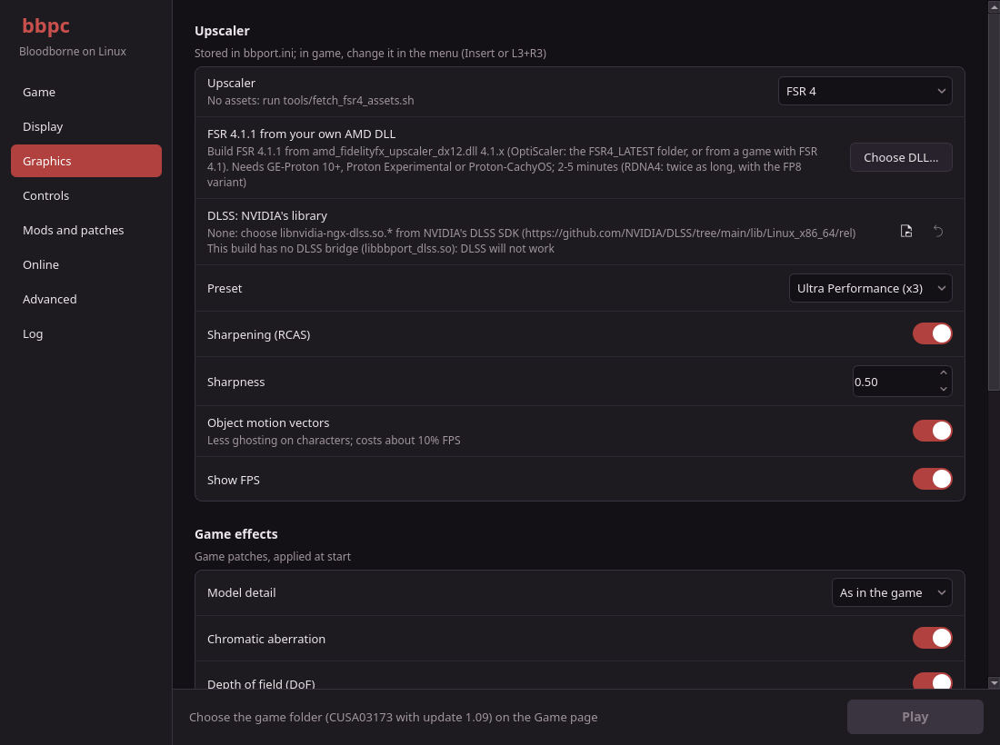

# bbpc

A native Linux port of *Bloodborne* (PlayStation 4, game version 1.09) with a Qt launcher, built
and tested on Arch Linux.

> **Credit where it is due:** bbpc is a fork of **[bloodborne_pc](https://github.com/deadinside28/bloodborne_pc)**
> ("bbport") by [deadinside28](https://github.com/deadinside28) and its contributors. The port
> itself (the loader and PS4 runtime, the renderer and shader translator, the memory model, the
> upscalers, online play and seamless co-op) is their work. This fork rebuilds the launcher, the
> build system and the packaging around it. See [Credits and licenses](#credits-and-licenses).

> **Disclaimer:** No game files are included: you need your own decrypted dump of Bloodborne with
> update 1.09. This project is not affiliated with Sony Interactive Entertainment, FromSoftware,
> AMD, NVIDIA or the shadPS4 project. Please report problems with this fork in
> [its issue tracker](https://github.com/wheat32/bbpc/issues), not on the shadPS4 or the original
> project's servers.

[](https://github.com/wheat32/bbpc/actions/workflows/ci.yml)

---



## What this fork changes

- **A new launcher in Qt 6** (C++23, Qt Widgets) in place of the original GTK4/libadwaita Python
  launcher: the same settings and features, on pages in a sidebar, with dark and light themes.
  It drives the port's own tools (`run.sh`, `bb-gpu-capabilities` and the Python helpers in
  `scripts/`), so the launcher and the game never disagree. It writes only the `bbport.ini` keys
  you change, so settings made in the in-game menu while the game runs are kept.
- **Arch Linux first.** Every dependency is an Arch package (`packaging/arch/packages.txt`,
  installed by `packaging/arch/install-deps.sh`); the Nix shells, the Nix package and the NixOS
  workarounds are gone.
- **One CMake project** for the GPU library, the loader, the tools, the launcher and every test,
  configured through `CMakePresets.json`. `build.sh` is a thin wrapper around it, and CLion opens
  the repository as it is (see [Developing in CLion](#developing-in-clion)).
- **A regular AppImage** (linuxdeploy) that uses the system's Vulkan drivers, like any native
  game, instead of a Nix closure with its own Mesa.
- **GitHub Actions**: every pull request is built and tested in an Arch Linux container, and every
  push to `main` publishes a release with the AppImage and a native tarball.
- **English documentation only**, trimmed to what is still useful.

## How the port works

The original project describes bbport as Wine + DXVK for one game, and that is still the best
summary:

- **As in Wine**, the game's x86-64 code runs directly on the CPU. The eboot is converted ahead of
  time (`scripts/`) into a flat memory image with the PS4's libc and libSceFios2 linked in as
  native code, and a small runtime written for this one game (`src/runtime_*.c`) implements the
  PS4 system functions Bloodborne calls: memory, threads, synchronization, files, audio (with
  ATRAC9), the gamepad, saves and add-on content. There is no CPU emulation.
- **As in DXVK**, the game's graphics are translated to Vulkan by the port's own command processor,
  renderer and shader translator (`gpu/`; they started from [shadPS4](https://github.com/shadps4-emu/shadPS4)'s
  and were rewritten). The PS4 command stream is decoded on one thread and recorded on another,
  GCN shaders are translated to SPIR-V, and memory writes, DMA and fences are executed by the GPU
  in stream order.
- **Memory follows the PC model** by default: the game's memory stays in system RAM and the GPU
  reads it in place, with frequently read data kept in VRAM and released when unused. The memory
  model of version 0.3 (VRAM copies with write tracking) remains an option.

### Highlights

- **Unlocked frame rate** through hooks in the game's code (the simulation uses the real frame
  time), plus 30/60/90 FPS modes; **F3** toggles a 30 FPS limit while playing.
- **Any aspect ratio, live:** 4:3, 16:10, 16:9, 21:9 and 32:9, with the HUD at the screen's edges.
- **Temporal upscaling built for this game:** the port computes motion vectors itself (camera
  motion from depth, object motion from the previous frame's vertices) and jitters the scene.
  Supported: **FSR 3.1**, **FSR 4** (INT8, model v07), **FSR 4.1.1** recorded from your own AMD DLL
  and replayed bit-exactly on Vulkan (INT8 everywhere, FP8 on RDNA4), **DLSS** with NVIDIA's SDK,
  and a native **TAA**.
- **Keyboard and mouse** with mouse look, a Dark Souls III-like layout, rebinding in the launcher,
  and button prompts that match the gamepad in use.
- **Settings inside the game's own menu** (*System → Display / Effects*), a **Quit Game** item at
  the bottom of the title menu, and an **overlay menu** (Insert or L3+R3).
- **Online play and seamless co-op** on shadPS4 0.20's network stack: the **Seamless Hunt** pool
  (bells, summons, messages, bloodstains and BBSC seamless co-op for up to five hunters) or **The
  Hunter's Dream** (Discord sign-in).
- **Mods, texture packs, shadPS4-format patches and DLC** ([docs/MODS.md](docs/MODS.md)).

The game boots, loads saves and plays with sound, gamepad and saving. A full play-through has not
been verified; the original project tested an AMD Radeon RX 7800 XT on Mesa/RADV most thoroughly,
where it reports about 90 FPS at 4K with FSR 4 Balanced.

## Requirements

- **Linux x86-64** with a **Vulkan 1.3** driver. Mesa (RADV, ANV) and NVIDIA's driver work; FSR 4
  and 4.1.1 need shader Float16, Int8/Int16, integer dot products and a few more features (RDNA2
  and newer qualify), and FSR 4.1.1 also `VK_VALVE_shader_mixed_float_dot_product`. Unsupported
  upscaler choices fall back to FSR 3.1 by themselves.
- **Your own decrypted dump of Bloodborne with update 1.09:** the base game folder (eboot.bin,
  sce_module, sce_sys, dvdroot_ps4) with the dumped 1.09 update copied over it, replacing files.
  Any retail release works (CUSA03173 in Europe, CUSA00900 in the US, CUSA03023 in Asia, ...): they
  share the same executable. The launcher and `run.sh` check the dump and say what is wrong (the
  base game alone, an eboot with a baked-in 60 FPS patch, a damaged extraction).
- **bash and Python 3.10 or newer**: `run.sh` prepares the game image with them.
- To build from source: the Arch packages in [packaging/arch/packages.txt](packaging/arch/packages.txt).

## Getting started on Arch Linux

```bash
git clone --recursive https://github.com/wheat32/bbpc.git
cd bbpc
bash packaging/arch/install-deps.sh
bash build.sh
```

`install-deps.sh` runs `sudo pacman -S --needed` with the package list (it works on Arch-based
distributions such as EndeavourOS and CachyOS too). `build.sh` configures and builds the `release`
preset into `out/`: `out/bb-probe` (the loader), `out/gpu/libbbgpu.so` (the renderer),
`out/gpu/libbbnet20.so` (the online module), `out/bb-gpu-capabilities` and the launcher
`out/launcher/bbpc`. Three header-only libraries (magic_enum, VulkanMemoryAllocator, xbyak) are
not in Arch's official repositories; CMake uses their AUR packages when they are installed and
downloads them otherwise.

Start the launcher:

```bash
bash launcher/bb-launcher.sh          # launcher/install-desktop.sh adds it to the application menu
```

Choose the game folder on the **Game** page, look through the other pages, and press **Play**. By
default the game is looked for in `game/CUSA03173` inside the checkout (ignored by git: put the
dump there, or a symlink to it with `ln -s /path/to/your/dumps game`), then next to the
repository (`../CUSA03173`). Saves and the shader
cache go to `user/` in the checkout unless you choose another folder; the port's settings go to
`bbport.ini`, which the in-game menu edits too.

Without the launcher, `run.sh` starts the game directly:

```bash
BB_GAME_DIR=/path/to/CUSA03173 bash run.sh
```

`run.sh` rebuilds what changed first, prepares the game image, applies the patches and starts
`out/bb-probe`; `BB_BUILD_DIR=out-debug bash run.sh` plays the debug preset's build instead.

### Prebuilt releases

Every push to `main` publishes a [release](https://github.com/wheat32/bbpc/releases) with:

- `Bloodborne-bbpc-<version>-x86_64.AppImage`: the launcher, the prebuilt port and the libraries
  it needs. It uses the system's Vulkan drivers, bash and Python; it needs a glibc at least as new
  as the Arch Linux it was built on, so on older distributions build from source.
- `bbpc-linux-x86_64.tar.gz`: the same files for Arch Linux, using the system's libraries.

The AppImage and the tarball keep their data (saves, `bbport.ini`, generated files) in
`~/.local/share/bbpc`. `--play` starts the game with the launcher's saved settings and no window,
which is what Steam's game mode wants: add the AppImage to Steam with *Add a Non-Steam Game* and
put `--play` in its launch options to skip the launcher. Where AppImages cannot mount (no FUSE),
set `APPIMAGE_EXTRACT_AND_RUN=1`. `--vulkan-info` prints the system's Vulkan drivers for bug
reports.

## The launcher

The launcher is a front end for `run.sh`: it builds the environment the game starts with from your
settings, starts and stops the game in its own process group, and shows its output.

| Page | What it sets |
|---|---|
| **Game** | Game folder (checked for the 1.09 executable), saves folder, the game's text language, memory and translation model, GPU, frame rate mode and limit |
| **Display** | Aspect ratio, output resolution, live resolution changes, fullscreen, monitor, present mode, HDR, the FPS counter |
| **Graphics** | Upscaler, preset, sharpening, object motion vectors, FSR 4.1.1 from your own AMD DLL, NVIDIA's DLSS library, model detail and the game's effects |
| **Controls** | The controller to use, keyboard, mouse and gamepad bindings, mouse look and sensitivity |
| **Mods and patches** | Mod folders with their load order, third-party XML patches |
| **Online** | Online play, the pool, servers, account or Discord sign-in, a connection test |
| **Advanced** | Performance options, developer diagnostics, extra variables, theme |
| **Log** | The game's output, with copy and export |

The launcher keeps its own settings in `~/.config/bbpc/launcher.json` (readable by you only: it
holds the online password and token). On its first start it imports the original GTK launcher's
`~/.config/bbport-launcher/settings.json`, which uses the same keys.

Command line: `bbpc --play` starts the game with the saved settings, `bbpc --build-fsr411
<amd_fidelityfx_upscaler_dx12.dll> [loader DLL]` builds the FSR 4.1.1 assets without a window, and
`bbpc --version` prints the version.

## Resolution and presets

For outputs other than 1080p (720p on the Steam Deck, 1440p, 4K), the whole game renders at the
preset's resolution through a patch applied at start: the fastest path, but changing the output or
the preset in the in-game menu then needs *Apply and restart game*. **Live resolution changes**
(off by default; launcher, in-game menu, or `live_resolution=0|1` in `bbport.ini`) keep the game
at 1080p internally and scale its render targets at run time instead, so outputs and presets switch
without a restart. That costs more (the game draws as for 1080p, and some targets are copied
between sizes): about 10% of the frame rate on an RTX 4080, more on weaker GPUs. The `auto` of older
settings means off. 1080p output and TAA always take the live path.

## Upscalers

- **FSR 3.1** needs nothing extra.
- **FSR 4** needs the v07 asset set (MIT, built from AMD's FidelityFX source by Q2RTX):
  `bash tools/fetch_fsr4_assets.sh`. The AppImage includes it.
- **FSR 4.1.1** is recorded from your own `amd_fidelityfx_upscaler_dx12.dll` version 4.1.x (for
  example OptiScaler's `FSR4_LATEST`, or the DLL of a game with FSR 4.1): **Graphics → FSR 4.1.1
  from your own AMD DLL → Choose DLL...**, or `bbpc --build-fsr411 <DLL>`. The DLL runs under
  Proton at 20 sizes, its passes are translated to SPIR-V, and the replay is bit-exact with the
  DLL. It takes 2 to 5 minutes (twice that on RDNA4, which also records the FP8 variant) and needs
  GE-Proton 10 or newer, Proton-CachyOS or Proton Experimental (the AUR's `proton-ge-custom` is
  found too); `umu-launcher` is used when installed. AMD's official FSR 4.0.x and community
  builds such as 4.0.2b do not fit. From source the recording also needs `mingw-w64-gcc`,
  `cmake`, `ninja`, `python`, `spirv-tools` and `git`; the AppImage brings its tools prebuilt.
- **DLSS** (NVIDIA RTX): the release AppImage and tarball carry the DLSS bridge and NVIDIA's
  `libnvidia-ngx-dlss.so` (NVIDIA's RTX SDK license allows its runtime library in an application;
  its text is `NVIDIA-DLSS-LICENSE.txt` in the package). From source, `bash tools/fetch_dlss_sdk.sh`
  fetches the parts of [NVIDIA's SDK](https://github.com/NVIDIA/DLSS) the build needs into
  `dlss-sdk/`; `DLSS_SDK_ROOT=$PWD/dlss-sdk bash build.sh` then builds the bridge
  `out/libbbport_dlss.so` and copies NVIDIA's `libnvidia-ngx-dlss.so.<version>` next to
  `out/bb-probe`. A newer
  `libnvidia-ngx-dlss.so` can be chosen in the launcher (**Graphics → DLSS: NVIDIA's library**).
  A game's `nvngx_dlss.dll` is the Windows library and does not load on Linux.
- **TAA** is a native-resolution temporal anti-aliasing mode that switches live without an FSR
  model. Sharpening (RCAS, 0 to 2) works with every upscaler and with TAA.

The design notes of the upscaling work are in [docs/upscaler.md](docs/upscaler.md).

## Online play

Online play uses the online module (`out/gpu/libbbnet20.so`: shadPS4 v0.20's network, NP and
shadNet code with the port's BBSC and The Hunter's Dream backends), which is built when protobuf,
nlohmann-json, OpenSSL, zlib and miniupnpc are installed. Turn it on in the launcher's **Online**
page and pick a pool:

- **Seamless Hunt** (default): a shadNet server with BBSC's game server
  (`play.seamlesshunt.com:31313`). Bells, summons, messages and bloodstains, plus **seamless co-op
  (BBSC)**: the session survives deaths, lamps, area changes, bosses and the Hunter's Dream, for up
  to five hunters. Make an account at [seamlesshunt.com](https://seamlesshunt.com). Details:
  [docs/BBSC.md](docs/BBSC.md).
- **The Hunter's Dream** ([thehuntersdream.com](https://thehuntersdream.com)): sign in with Discord
  from the launcher and confirm the code on the website. No BBSC.

Everyone in a session needs game version 1.09 and the same server; online play works together with
the Windows version of the port. Offline, the module is never loaded.

## Useful environment variables

`run.sh` and the runtime read many `BB_*` variables; the launcher sets most of them from its
settings, and **Advanced → Extra variables** adds your own. A selection:

| Variable | Effect |
|---|---|
| `BB_GAME_DIR` | The game folder (default `game/CUSA03173`, else `../CUSA03173`) |
| `BB_BUILD_DIR` | The build folder `run.sh` plays from source (default `out`) |
| `BB_FRAME_STATS=1` | Frame statistics in the log, with a `Memory:` line (VRAM, GTT, RSS) |
| `BB_PC_MODEL=0` | The old memory model of 0.3 (the new one is the default) |
| `BB_UPSCALER=taa\|fsr3\|fsr4\|fsr411\|off` | The upscaler, over `bbport.ini` |
| `BB_LIVE_RES=1` | Live resolution changes instead of the start-up patch |
| `BB_GPU_ID=N` | The GPU by its Vulkan index (the launcher picks it by name) |
| `BB_GPU_PROFILE=1` | GPU time per pass in the log |
| `BB_ANISO=N` | Anisotropic filtering of scene textures (16 by default, 0 for the game's own) |
| `BB_FRAMES_AHEAD=N` | How far the GPU command thread may run ahead (1 by default, 0 unbounded) |
| `BB_ASYNC_PIPELINES=0` | Compile new pipelines at once instead of in the background |
| `BB_READBACKS=0\|1\|2` | Reads of GPU-written memory by the game (1 by default, 2 precise and slow) |
| `BB_LARGE_HEAPS=0\|1` | Force the larger graphics heaps for texture packs off or on |
| `BB_TITLE_QUIT=0` | No Quit Game item in the title menu |
| `BB_SKIP_GAME_CHECK=1` | Skip the check of the game's executable |
| `BB_PAD_RECORD=file` / `BB_PAD_REPLAY=file` | Record a route with F9, replay it in scripted tests |

## Developing in CLion

```bash
bash clion.sh
```

`clion.sh` checks out the submodules if needed and opens the repository in CLion (from `PATH`,
the AUR or JetBrains package, Toolbox or Flatpak; `CLION=/path/to/clion` picks another). CLion
loads the presets of `CMakePresets.json` as its CMake profiles:

| Preset | Build folder | Use |
|---|---|---|
| `release` | `out/` | Optimized with debug info and LTO: what `run.sh` and `build.sh` use |
| `debug` | `out-debug/` | Unoptimized, with the tests |
| `launcher` | `out-launcher/` | The Qt launcher and its tests alone, without the game's dependencies |

The shared run configurations in `.run/` appear in CLion's run menu: **Launcher** (the Qt target),
**Play (run.sh)**, **Play debug build (run.sh)** (sets `BB_BUILD_DIR=out-debug`), and **Build and
test (build.sh --test)**; CLion also makes an *All CTest* configuration for the test suite. To
debug the game itself, start one of the *Play* configurations and use **Run → Attach to Process**
on `bb-probe`.

CLion also picks up the code style: `.clang-format` lays out the port's C and C++ code (Code →
Reformat Code), and `.clang-tidy` flags the [AGENTS.md](AGENTS.md) rules it can check as you type.
Vendored code has its own copies of both files that turn them off.

From a terminal the same presets work with plain CMake:

```bash
cmake --preset debug && cmake --build --preset debug && ctest --preset debug
```

`bash build.sh --test` builds the release preset with the tests and runs them: the runtime's C
tests, the GPU library's tests, the Python tests of `scripts/` and `run.sh`, and the launcher's Qt
tests.

## Repository layout

| Path | Contents |
|---|---|
| `src/` | The loader (`probe.c`) and the PS4 runtime |
| `scripts/` | Offline preparation of the game image, module linking, the patch compiler, mods, online helpers, the launcher's queries (`launcher_query.py`) |
| `gpu/` | The renderer library: command processor, shader translator, renderer, caches, in-game menu, upscalers, the online module (`gpu/bbnet20`) and the DLSS bridge (`gpu/dlss_bridge`) |
| `launcher/` | The Qt launcher (`core/`: settings and logic, `pages/`, `widgets/`, `tests/`) |
| `packaging/` | Arch package list and installer (`arch/`), AppImage (`appimage/`) |
| `patches/` | Community patches for Bloodborne |
| `tools/` | Developer tools: scripted runs, A/B toggles, benchmarks, FSR 4 shader rewrites, `fsr4cap` (FSR 4.1.1 recording) |
| `tests/` | Runtime, GPU library and Python tests |
| `docs/` | The [roadmap](docs/ROADMAP.md) (native speed, no emulation), [mods and patches](docs/MODS.md), [BBSC](docs/BBSC.md), design notes on [upscaling](docs/upscaler.md) and [parallel GPU processing](docs/parallel_gpu.md) |
| `.github/workflows/` | CI (pull requests) and releases (pushes to `main`) |

The original project's change logs, development logs and investigations are in
[its repository](https://github.com/deadinside28/bloodborne_pc/tree/main/docs).

## Credits and licenses

bbpc is licensed under the **GNU GPL v2 or later** ([LICENSE](LICENSE)), as the original project is.

- **[bloodborne_pc](https://github.com/deadinside28/bloodborne_pc)** by deadinside28 and its
  contributors: the port this fork is built on, in its entirety.
- **[shadPS4](https://github.com/shadps4-emu/shadPS4)** (GPL-2.0-or-later): the starting point of
  the renderer and shader translator, and the network and NP code of the online module
  ([v0.20](https://github.com/shadps4-emu/shadPS4/tree/v.0.20.0)). Without shadPS4 there would be no
  port.
- [sirit](https://github.com/shadps4-emu/sirit), [half](https://half.sourceforge.net/),
  [FSR-Vulkan](https://github.com/FireBurn/FSR-Vulkan) by FireBurn (MIT: FSR 3.1 on Vulkan and the
  FSR 4 v07 provider), the AMD FidelityFX SDK (MIT), [LibAtrac9](https://github.com/Thealexbarney/LibAtrac9)
  (MIT), [Dear ImGui](https://github.com/ocornut/imgui) (MIT), DejaVu fonts,
  [dxil-spirv](https://github.com/HansKristian-Work/dxil-spirv) (MIT, for the FSR 4.1.1 assets).
- [BBSC](https://github.com/CLSAMG22/BBSC) seamless co-op (GPL-2.0-or-later) and The Hunter's Dream
  backend from [droogie/bbhost](https://github.com/droogie/bbhost) (GPL-3.0-or-later, so
  `libbbnet20.so` as a whole is GPL-3.0-or-later).
- The DLSS bridge (`gpu/dlss_bridge`, MIT) is adapted from
  [IFreemz/shadPS4-Bloodborne-DLSS-FSR](https://github.com/IFreemz/shadPS4-Bloodborne-DLSS-FSR).
- Game patches by Kyo, Lance McDonald, auser1337, illusion, emoose and other community members
  (`patches/Bloodborne.xml`).

This repository does not include AMD's FSR 4 DLLs and model data or NVIDIA's DLSS SDK. The
release packages carry NVIDIA's DLSS runtime library, under NVIDIA's license.
